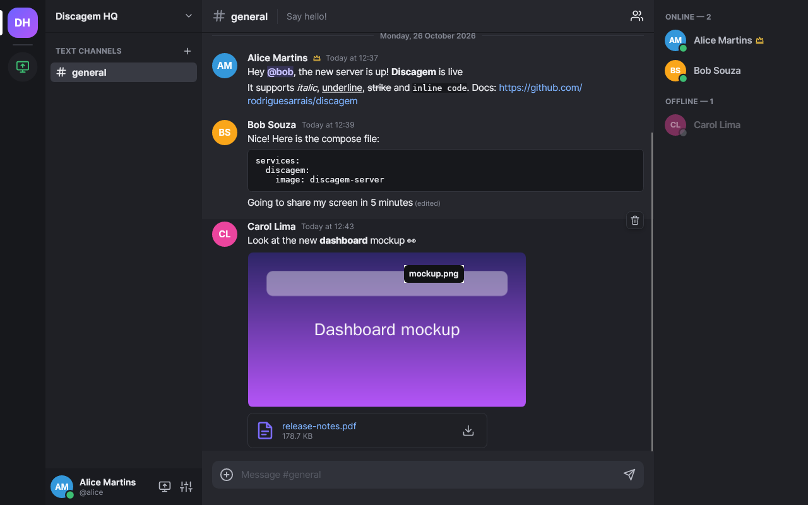
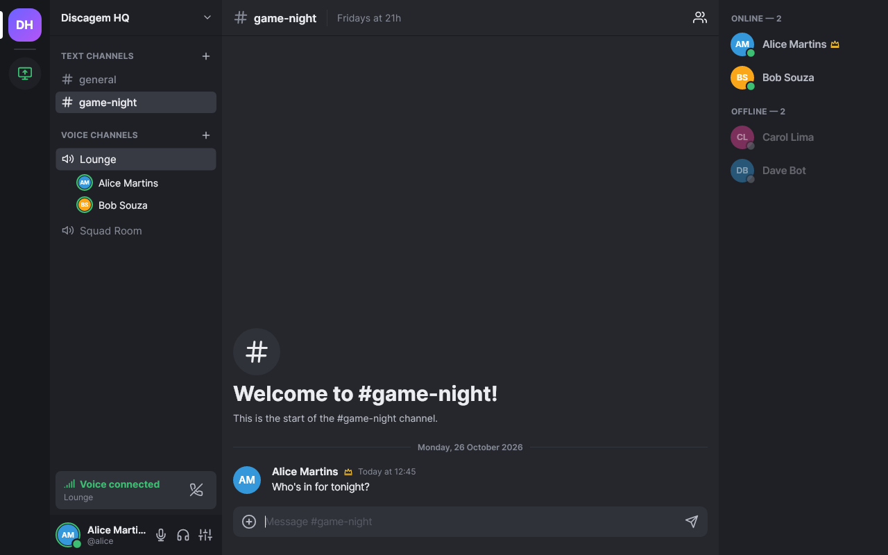
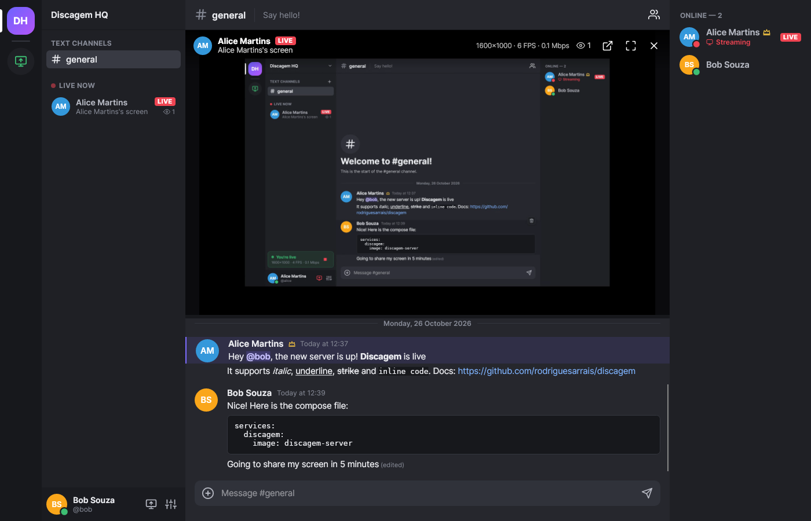
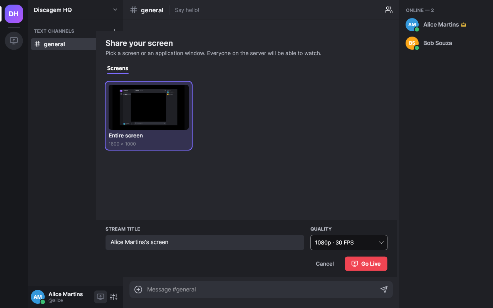
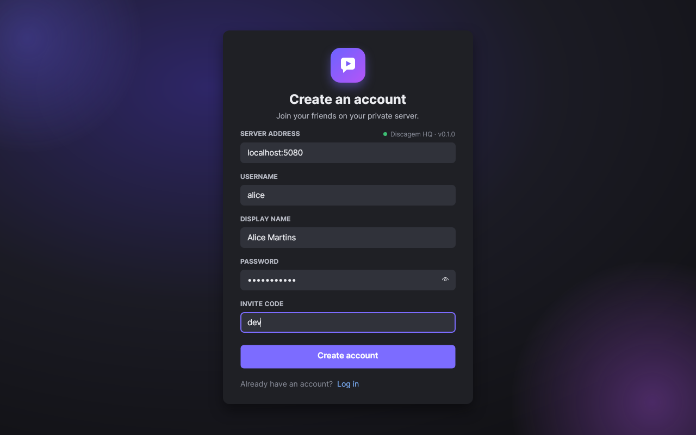

# Discagem

A self-hosted, Discord-style chat with voice channels and screen sharing, written entirely in C#.
The server is ASP.NET Core and runs on a single private VPS; the desktop client is a
native Avalonia application for Windows (and Linux/X11).



| In a voice channel | Watching a screen share |
| --- | --- |
|  |  |
| **Choosing what to share** | **Signing in** |
|  |  |

## Features

**Text chat**
- Text channels (created, renamed and deleted by the administrator), with unread and mention badges.
- Messages grouped by author and day, Discord-like markdown (`**bold**`, `*italic*`, `__underline__`,
  `~~strike~~`, `` `code` ``, fenced code blocks, quotes), clickable links and `@mentions`.
- Edit (`↑` edits your last message) and delete; administrators can delete any message.
- Image previews and file attachments (button, drag and drop, or paste a screenshot or copied files
  with Ctrl+V), up to 25 MB by default.
- Profile photos, cropped to a square and shown in messages, the member list, voice channels and
  streams (*Settings → My account → Change photo*); without one, the initials on a colour.
- Typing indicators, online/offline presence, history paging and automatic reconnection.

**Voice chat**
- Voice channels alongside text channels: click one to join, see who is in it and who is speaking.
- Opus at 48 kHz with forward error correction, an adaptive jitter buffer and packet loss concealment.
- Mute and deafen (remembered between sessions), input sensitivity with a live level meter, output
  volume and per-person volume (right-click someone in the channel).
- Choice of microphone and speakers; unplugged devices fall back to the system default.
- On Windows the microphone uses the system's communications processing (echo cancellation, noise
  suppression, automatic gain) where the device supports it.
- Rejoins automatically after a dropped connection.

**Screen sharing**
- Share a whole monitor or a single application window, with live thumbnails in the picker.
- Sound comes along in stereo, and voice chat never does: sharing a screen sends everything the
  computer plays except Discagem itself, and on Windows sharing a window sends only that
  application's sound. Viewers get a volume control per streamer, and deafening silences streams
  too. The streamer and the viewers see whether sound is being sent and received.
- Quality presets from 720p30 to 1440p30 / source resolution; VP8 tuned for screen content.
- Any number of people can watch at the same time; the stream can be popped out or shown full screen.
- Live statistics (resolution, frame rate, bitrate) for both the streamer and viewers.

**Desktop app**
- Keeps running in the notification area when its window is closed (on by default on Windows, an
  option in *Settings → App*); launching it again brings the window back instead of a second copy.
- Checks the GitHub releases for new versions at start-up and every six hours. Installed with the
  Windows installer, it updates itself in one click: it downloads the new installer, verifies it
  against the release's `SHA256SUMS`, installs it silently and restarts. Other builds link to the
  release page.

**Private by design**
- Accounts require an invite code; the first account becomes the administrator.
- Everything runs on your server: no third-party STUN/TURN or media services are involved.

## Architecture

```
 Desktop client (Avalonia)                            VPS
┌──────────────────────────┐   HTTPS + WSS    ┌─────────┐  HTTP   ┌──────────────────────────────┐
│ REST client              │ ───────────────► │  Caddy  │ ──────► │ ASP.NET Core                 │
│ SignalR client           │  (TLS, :443)     │ (:443)  │ (:5080) │  • REST: auth, uploads       │
│                          │                  └─────────┘         │  • SignalR hub: chat,        │
│ WebRTC peer (SIPSorcery) │                                      │    presence, signalling      │
│  screen → VP8 → RTP      │ ◄──────────── UDP 50000-50999 ─────► │  • SFU (SIPSorcery WebRTC)   │
│  RTP → VP8 → display     │      ICE · DTLS-SRTP · RTP/RTCP      │    for video and voice       │
│  mic ⇄ Opus ⇄ speakers   │                                      │  • STUN responder (UDP 3478) │
└──────────────────────────┘                                      │  • SQLite + file storage     │
                                                                  └──────────────────────────────┘
```

| Concern | Protocol |
| --- | --- |
| Sign-in, profile, file upload/download | HTTPS (REST + JWT bearer tokens) |
| Messages, typing, presence, stream and voice state | SignalR over WebSocket |
| Media signalling | SDP offer/answer and trickled ICE candidates over the SignalR hub |
| Screen-share media | WebRTC: ICE, DTLS-SRTP, RTP/RTCP with NACK and PLI feedback; Opus for the audio |
| Voice media | WebRTC: ICE, DTLS-SRTP, Opus over RTP |

### How screen sharing works

The server acts as an **SFU** (selective forwarding unit): the streamer uploads one video stream and
the server forwards it to every viewer. Because every client only talks to the server, which has a
public address, no TURN server or peer-to-peer NAT traversal is needed.

1. The streamer's client captures the screen (GDI on Windows, X11 on Linux), scales it, converts it to
   I420 and encodes it with libvpx (VP8 in real-time screen-content mode, CBR).
2. Frames are split into RTP packets and paced onto the network, so key frames do not leave as a burst.
3. The server forwards each packet to every viewer, keeps a short history, answers viewers' NACKs from
   that history, NACKs the streamer for packets lost on the uplink, and relays key frame requests (PLI).
4. Viewers reorder packets in a jitter buffer, request retransmissions of missing ones, decode VP8 and
   draw the picture. After unrecoverable loss they wait for (and request) the next key frame.

The RTP payload starts with a standard one-byte VP8 descriptor followed by a 16-bit *media sequence
number* that is preserved end to end. Retransmissions therefore travel with fresh RTP sequence numbers,
which keeps them clear of the SRTP replay window (see `src/Discagem.Media/Rtp/VideoPayload.cs`).
A simple loss-based controller lowers the bitrate when the streamer's uplink drops packets.

The stream's sound travels as a second track on the same connection: 48 kHz stereo Opus at
128 kbit/s in 20 ms frames, paused during silence. Discagem's own sounds (voice chat, watched
streams) are always left out, so the people in a call never hear themselves through a stream. On
Windows (10 version 2004 or later) the sound is captured with WASAPI process loopback, either from the
shared window's application and its child processes or from everything except Discagem; Windows
offers no way to leave voice chat out on older versions, so they share no sound. On Linux Discagem
records every PulseAudio/PipeWire playback stream except its own, each through its own monitor
stream, and mixes them, picking up applications that start playing later. The server forwards the
packets with the streamer's sequence numbers, as it does for voice, and viewers play them through a
jitter buffer with loss concealment. Clients from before stream audio keep working: they simply
receive the video only.

### How voice works

Voice goes through the same SFU. Each participant sends a single Opus stream (48 kHz mono, 20 ms
frames, about 40 kbit/s, in-band FEC) and the server forwards every packet to the other people in
the channel, prefixed with the speaker's id and sequence number (`src/Discagem.Media/Audio/VoicePayload.cs`).
The server never decodes or mixes audio, so it stays cheap; it simply skips muted and deafened people.

1. The client filters the microphone signal (DC blocking), measures its level and only encodes and
   sends while it is above the input sensitivity threshold, plus a short hangover and one frame of
   pre-roll. Silence costs no bandwidth, and this is what drives the speaking indicators.
2. Every remote speaker gets an adaptive jitter buffer (about twice the measured jitter, 40 ms
   minimum) in front of an Opus decoder. Lost frames are rebuilt from the next packet's FEC data or
   concealed; if latency builds up, frames are dropped to catch up.
3. The speakers are mixed (with per-person volume and the join/leave sounds) and played through
   WASAPI on Windows or PulseAudio/PipeWire on Linux.

Mouth-to-ear latency is roughly the network round trip to the server and back, plus 60-100 ms of
framing, jitter buffering and device buffers.

## Releases

Every [release](https://github.com/rodriguesarrais/discagem/releases) contains the Windows client
(installer and portable zip), the Linux client, self-contained server builds for x64 and ARM64 Linux,
and a `SHA256SUMS` file; the server image is published as `ghcr.io/rodriguesarrais/discagem-server`
(`latest` is the newest stable release).

To publish a release, push a version tag, or run the *Release* workflow from the Actions tab and
enter the version:

```bash
git tag v0.2.0 && git push origin v0.2.0
```

The workflow tests the code, builds everything, pushes the image and creates the release with
generated notes. Versions with a suffix (`0.2.0-beta.1`) are marked as pre-releases and do not move
`latest`.

## Running the server on a VPS

Requirements: a Linux VPS with a public IP, Docker with the Compose plugin, and a DNS name pointing to
the server (for example `chat.example.com`).

1. **Open the firewall.** TCP `80` and `443` (Caddy/HTTPS), UDP `3478` (STUN) and UDP `50000-50999`
   (media). With `ufw`:
   ```bash
   sudo ufw allow 80/tcp && sudo ufw allow 443/tcp
   sudo ufw allow 3478/udp && sudo ufw allow 50000:50999/udp
   ```
   Cloud providers usually have an additional firewall/security group: open the same ports there.
2. **Configure.**
   ```bash
   git clone https://github.com/rodriguesarrais/discagem.git && cd discagem/deploy
   cp .env.example .env
   nano .env   # set DISCAGEM_DOMAIN and a long, random Discagem__InviteCode
   ```
   If the VPS sits behind 1:1 NAT (its network interface only has a private address, as on AWS,
   Google Cloud or Oracle Cloud), also set `Discagem__Media__PublicIpAddress` to the public IP.
3. **Start it.**
   ```bash
   docker compose up -d --build
   docker compose logs -f discagem
   ```
   To run a released image instead of building one, set `DISCAGEM_IMAGE` in `.env` (for example
   `ghcr.io/rodriguesarrais/discagem-server:latest`) and use
   `docker compose pull discagem && docker compose up -d --no-build`. GitHub creates the image as a
   private package: either make it public (the package's *Package settings → Change visibility*) or
   log in on the server first with `docker login ghcr.io` and a token that can read packages.
   Caddy obtains a Let's Encrypt certificate automatically. Data (SQLite database, uploads and the
   token signing key) lives in the `discagem-data` volume; back it up to keep your history.
4. **Create the administrator.** Open the client, choose *Register*, enter your domain, the invite code
   and your details. The first account is the administrator; share the invite code with your friends.

### Without Docker

Extract `discagem-server-<version>-linux-x64.tar.gz` (or `-linux-arm64`) from a release into
`/opt/discagem`, or build it yourself:

```bash
dotnet publish src/Discagem.Server -c Release -r linux-x64 --self-contained -o /opt/discagem
sudo useradd --system --home /var/lib/discagem --create-home discagem
echo 'Discagem__InviteCode=change-me' | sudo tee /etc/discagem.env
sudo cp deploy/discagem.service /etc/systemd/system/
sudo systemctl daemon-reload && sudo systemctl enable --now discagem
```

Then put a TLS reverse proxy in front of `127.0.0.1:5080` (the `deploy/Caddyfile` works with a
native Caddy install as well).

### Server configuration

Settings live in `src/Discagem.Server/appsettings.json` and can be overridden with environment
variables (`Section__Key`, as in `.env.example`).

| Setting | Default | Description |
| --- | --- | --- |
| `Urls` | `http://127.0.0.1:5080` | HTTP listen address (keep it on loopback behind the proxy). |
| `Discagem:ServerName` | `Discagem` | Name shown in the client. |
| `Discagem:InviteCode` | *(empty)* | Required to register. When empty only the first account can be created. |
| `Discagem:DataDirectory` | `data` | Database, uploads and generated signing key. |
| `Discagem:MaxUploadBytes` | `26214400` | Maximum attachment size. |
| `Discagem:Jwt:Key` | *(generated)* | Token signing key (32+ characters). Generated and stored in the data directory when empty. |
| `Discagem:Jwt:LifetimeDays` | `30` | Session lifetime; clients refresh their token on start-up. |
| `Discagem:Media:PublicIpAddress` | *(empty)* | Public IP to announce when behind 1:1 NAT. |
| `Discagem:Media:BindAddress` | *(empty)* | Local address for media sockets. |
| `Discagem:Media:RtpPortStart` / `RtpPortEnd` | `50000` / `50999` | UDP range for media; each stream, viewer and voice participant uses one port. |
| `Discagem:Media:StunPort` | `3478` | Built-in STUN responder (`0` disables it). |
| `Discagem:Media:IceServers` | `[]` | Extra ICE servers handed to clients (e.g. a TURN server). |
| `Discagem:Media:MaxViewersPerStream` | `25` | Viewer limit per stream. |

## Installing the client

### Windows

Download `Discagem-<version>-win-x64-setup.exe` from the latest release and run it. The installer
needs no administrator rights: it installs Discagem for the current user in
`%LOCALAPPDATA%\Programs\Discagem`, adds a Start menu shortcut (and, optionally, a desktop shortcut)
and registers an uninstaller. When a new release is out, the client offers *Update now*, which
replaces the previous version, keeps your settings and restarts Discagem (running a newer installer by
hand does the same). Uninstall from *Settings → Apps → Installed apps*; your settings and saved
session are kept unless you tick *Settings and saved session*. The installer and
the client are not code-signed, so SmartScreen may warn the first time: choose *More info → Run
anyway*. For unattended installs, run the installer with `/S`.

`Discagem-<version>-win-x64.zip` is the portable alternative: extract it anywhere and run
`Discagem.exe`.

To build them yourself with the .NET 10 SDK:

```bash
# Installer, written to dist/ (needs NSIS 3: "sudo apt install nsis" on Debian/Ubuntu)
installer/windows/build.sh 0.2.0 dist
```

```powershell
# Portable single-file build
dotnet publish src/Discagem.Client -c Release -r win-x64 --self-contained `
  -p:PublishSingleFile=true -p:IncludeNativeLibrariesForSelfExtract=true `
  -p:EnableCompressionInSingleFile=true -o publish/win-x64
```

In the portable build, keep `Discagem.exe` and `vpxmd.dll` (the VP8 codec) together. Screen sharing
needs the [Microsoft Visual C++ Redistributable (x64)](https://aka.ms/vs/17/release/vc_redist.x64.exe),
which most machines already have; the installer offers to open its download page when it is missing,
and the client tells you as well.

While you are in a voice channel, Windows may lower the volume of other applications (its default
"communications activity" setting). To turn that off, open *Sound settings → More sound settings →
Communications* and choose *Do nothing*.

### Linux

Install libvpx (`sudo apt install libvpx9` on Ubuntu 24.04, `libvpx7` on older releases), then run
`Discagem` from `Discagem-<version>-linux-x64.tar.gz` in the latest release, or
`dotnet run --project src/Discagem.Client` from source. Screen sharing requires an X11 session; Wayland capture is
not implemented yet. Voice uses PulseAudio, or PipeWire's PulseAudio service, which desktop
distributions ship by default; there is no echo cancellation on Linux, so use headphones.

Settings and the saved session are stored in `%APPDATA%\Discagem` (Windows, with the session token
encrypted by DPAPI) or `~/.config/Discagem` (Linux). Set `DISCAGEM_PROFILE=name` to run several
clients side by side with separate profiles.

If something does not work (a stream without sound, say), *Settings → About → Open log folder* shows
`discagem.log`, which records how audio and streams were set up and any errors.

## Development

Requirements: .NET 10 SDK and libvpx (for the media tests and the client on Linux).

```bash
# Server on http://localhost:5080 (invite code "dev", see appsettings.Development.json)
ASPNETCORE_ENVIRONMENT=Development dotnet run --project src/Discagem.Server

# Client
dotnet run --project src/Discagem.Client

# Tests: unit tests plus integration tests that stream video and voice through the SFU over real UDP sockets
dotnet test
```

Without audio hardware, `DISCAGEM_TEST_TONE=440` replaces the microphone with a tone and
`DISCAGEM_TEST_RECORD=/tmp/out.f32` writes what would be played to a raw 48 kHz mono float file.

See [CONTRIBUTING.md](CONTRIBUTING.md) for the branch and commit conventions (Conventional Commits).

Database schema changes use EF Core migrations
(`dotnet ef migrations add <Name> --project src/Discagem.Server --output-dir Data/Migrations`);
they are applied automatically on start-up.

### Project layout

| Path | Contents |
| --- | --- |
| `src/Discagem.Shared` | DTOs, hub contracts and the chat markup parser shared by server and client. |
| `src/Discagem.Media` | libvpx VP8 binding, colour conversion and scaling, RTP payload format, pacer, jitter buffer, NACK tracking, WebRTC publisher/viewer and the capture/encode/decode pipelines; the voice engine (Opus, voice activity detection, per-speaker jitter buffers, mixer). |
| `src/Discagem.Server` | ASP.NET Core host: auth, attachments, SignalR hub, SFU, STUN responder, EF Core (SQLite). |
| `src/Discagem.Client` | Avalonia desktop app (MVVM with CommunityToolkit.Mvvm), screen capture for Windows and X11, audio devices (WASAPI, PulseAudio). |
| `tests/Discagem.Tests` | xUnit tests for media, voice, markup, REST, hub and end-to-end streaming and voice. |
| `deploy/` | Dockerfile, Compose file with Caddy, environment template and systemd unit. |
| `installer/windows/` | NSIS script, wizard images and build script of the Windows installer. |
| `.github/workflows/` | CI (build, tests, Windows client artifact, image build) and the release workflow. |

## Security notes

- Registration requires the invite code; login and registration are rate limited per IP.
- Passwords are hashed with ASP.NET Core Identity's PBKDF2 hasher. Changing the password revokes
  existing sessions and closes their open connections.
- Run the server behind HTTPS (the Compose setup does this with Caddy). Media is always encrypted with
  DTLS-SRTP.
- Attachments are only served to signed-in users (and, until posted, only to the uploader); only
  common image types are served inline.
- Profile photos are only served to signed-in users; the server accepts PNG and JPEG files of at most
  1 MB (the client uploads a 256 × 256 PNG) and serves them with the type their contents show.

## Limitations and ideas

- Voice has no push-to-talk yet, and no noise suppression or echo cancellation on Linux.
- Voice packets are forwarded unmixed, so each listener receives one stream per person speaking at
  that moment; this is fine for the 25-person channel limit.
- On Linux, only whole screens can be shared (not single windows), so a stream's sound is every
  application's except Discagem's.
- Stream audio and video are not explicitly synchronised; both use short buffers, so they stay close.
- Capture uses GDI on Windows; DXGI Desktop Duplication and hardware H.264 encoding would lower CPU usage.
- Networks that block all outbound UDP cannot receive streams (there is no TCP/TURN fallback).
- Wayland and macOS capture are not implemented.
